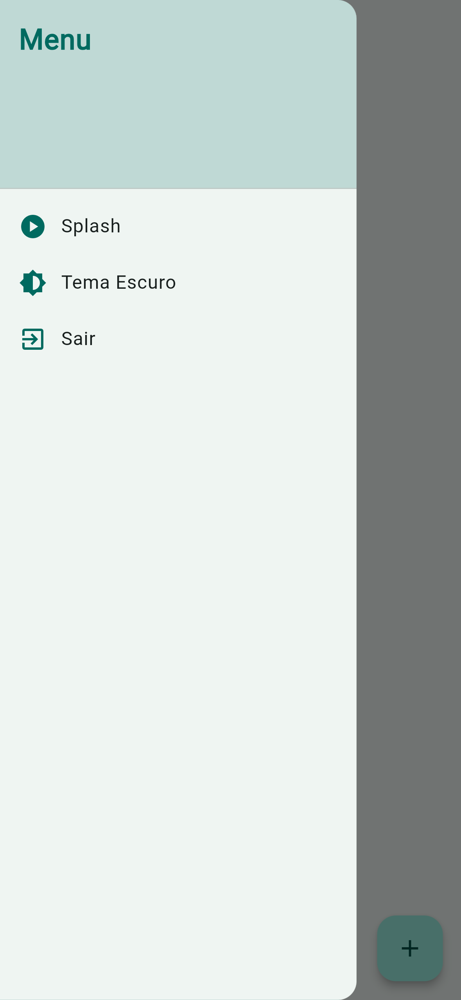
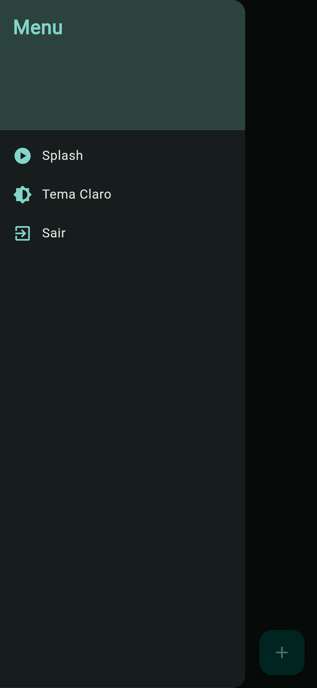
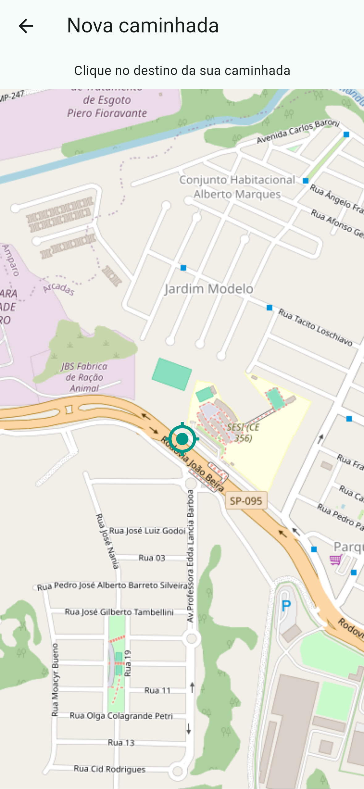
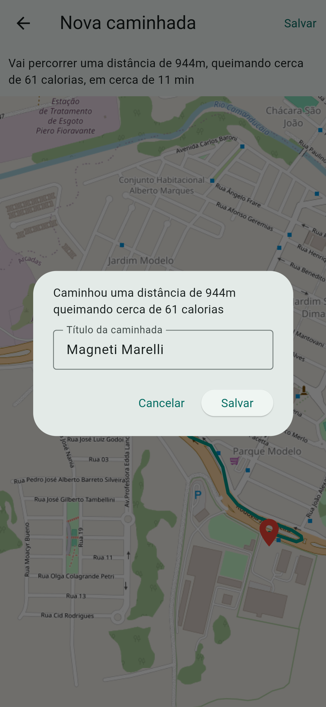
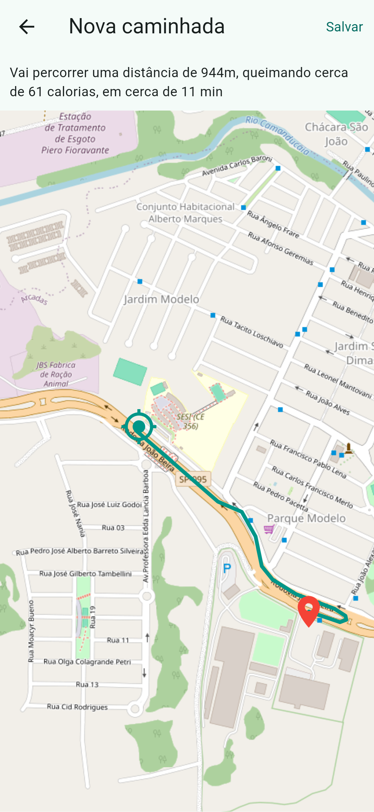
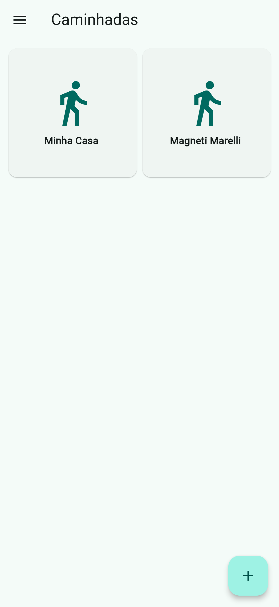

# 🚶‍♂️‍➡️ App Caminhadas
Um aplicativo mobile moderno desenvolvido em **Flutter** para registro e acompanhamento de caminhadas. Escolha seu destino no mapa, visualize o trajeto, calcule estimativas de distância, tempo e gasto calórico, e mantenha todo o histórico salvo localmente no seu dispositivo.

## 📱 Prints das Telas

## 📱 Prints das Telas

## ✨ Funcionalidades

- 🚀 **Splash Screen:** Tela inicial com animação fluida de entrada e saída.
- 🏠 **Home:**
  - Listagem completa das caminhadas registradas.
  - Menu lateral (*Drawer*) com alternância de tema (claro/escuro), atalhos e opção de sair.
  - Botão de ação flutuante (`+`) para iniciar um novo registro.
- 🗺️ **Nova Caminhada:**
  - Seleção de destino interativa diretamente no mapa.
  - Traçado de rota a pé com cálculo automático de **distância**, **calorias** e **tempo estimado**.
  - Modal para definição de título personalizado e salvamento.
- 📌 **Detalhes da Atividade:**
  - Exibição do mapa com o trajeto percorrido e resumo de métricas.
  - Captura e exibição de foto da caminhada (integração com a câmera do dispositivo).

---

## 🛠️ Tecnologias Utilizadas

- **[Flutter](https://flutter.dev/) & [Dart](https://dart.dev/)** — Framework e linguagem base.
- **`flutter_map` & `latlong2`** — Renderização de mapas via OpenStreetMap.
- **`geolocator`** — Captura da localização e coordenadas do usuário.
- **`image_picker`** — Acesso à câmera para fotos da caminhada.
- **`shared_preferences`** — Armazenamento e persistência de dados localmente.
- **`http`** — Requisições de rotas e rotas a pé via API.

---

## 💻 Como Executar o Projeto

### Pré-requisitos
É necessário ter o **[Flutter SDK](https://docs.flutter.dev/get-started/install)** instalado e configurado no seu ambiente de desenvolvimento.

### Passo a passo

1. **Clone o repositório:**
2. **flutter run**